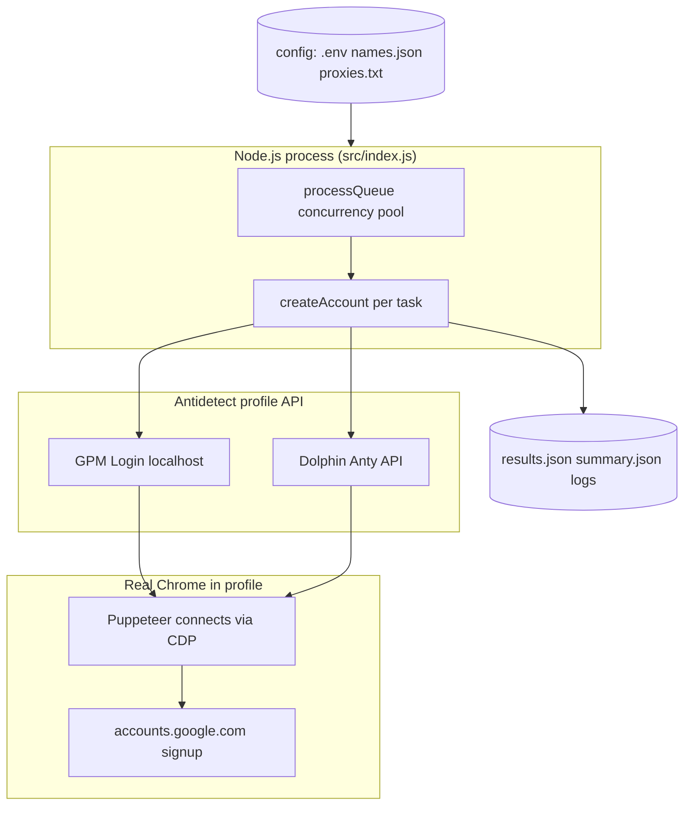
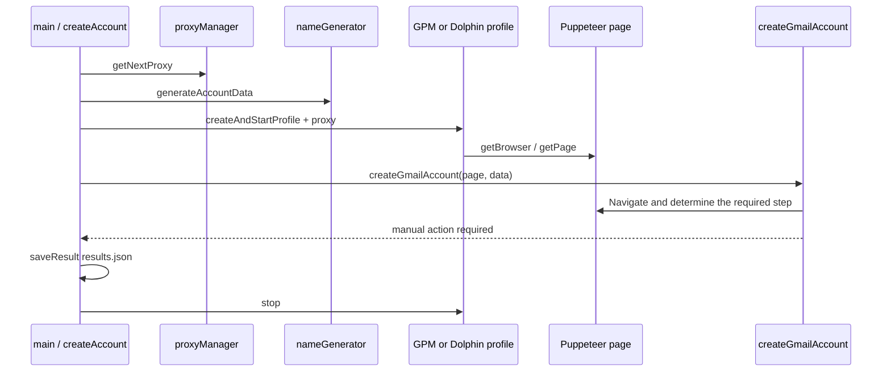
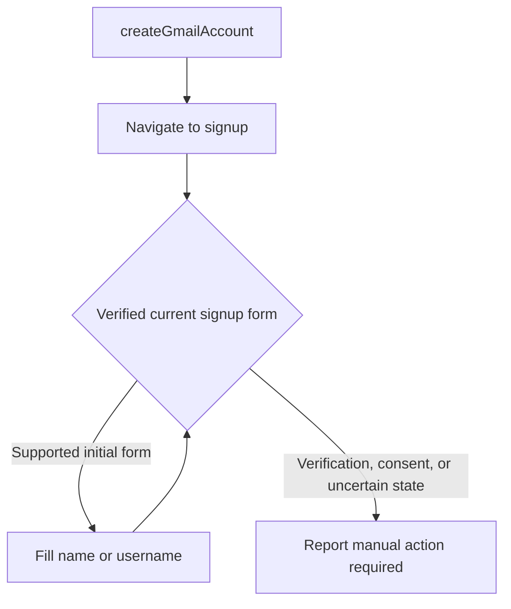

# Gmail Account Creator

[](https://nodejs.org/)
[](https://nodejs.org/api/esm.html)
[](LICENSE)
[](https://pptr.dev/)
[](https://github.com/code-root/gmail-account-creator)
[](https://github.com/code-root/gmail-account-creator/releases)
[](https://github.com/code-root/gmail-account-creator/pkgs/npm/gmail-account-creator)

## Table of contents

**Jump to:** [Arabic README (`README_AR.md`)](README_AR.md#فهرس-المحتويات) · [Repository on GitHub](https://github.com/code-root/gmail-account-creator)

| Section | |
|--------|---|
| [About](#about) | [Repository metadata (GitHub)](#repository-metadata-github) |
| [Features](#features) | [Tech stack](#tech-stack) |
| [How it works (high level)](#how-it-works-high-level) | [Architecture diagrams](#architecture-diagrams) |
| [Module map](#module-map) | [Function reference](#function-reference) |
| [Prerequisites](#prerequisites) | [Installation](#installation) |
| [Configuration highlights](#configuration-highlights) | [Usage](#usage) |
| [Project layout](#project-layout) | [Releases & GitHub Packages](#releases--github-packages) |
| [Suggested GitHub Actions workflows](#suggested-github-actions-workflows-this-stack) | [Maintainer, company & contact](#maintainer-company--contact) |
| [Support this project](#support-this-project) | [Legal & ethics](#legal--ethics) |
| [Links](#links) | |

**Architecture diagrams**

- [System context](#system-context)
- [One attempt through handoff](#one-attempt-through-handoff)
- [Gmail signup sub-flow (logical)](#gmail-signup-sub-flow-logical)
- [Concurrency model](#concurrency-model)

**Releases & Packages (subsections)**

- [Option A — Automated release (recommended)](#option-a--automated-release-recommended)
- [Option B — “Create a new release” in the GitHub UI](#option-b--create-a-new-release-in-the-github-ui)
- [Install from GitHub Packages](#install-from-github-packages)
- [Publish workflow](#publish-workflow)

**Support**

- [Deposit QR codes (Binance / BSC)](#deposit-qr-codes-scan-in-binance-or-any-bsc-wallet)

---

## About

**Gmail Account Creator** opens a Google signup flow in a browser profile and records the outcome in JSON. The CLI handles recognized initial fields and records `MANUAL_SIGNUP_REQUIRED` when the account holder needs to take over. Wait for confirmation that the managed profile has stopped before continuing in a trusted browser you control.

| | |
|--|--|
| **Repository** | [github.com/code-root/gmail-account-creator](https://github.com/code-root/gmail-account-creator) |
| **Releases** | [**Releases** tab](https://github.com/code-root/gmail-account-creator/releases) — source archives + `.tgz` from CI when you push a `v*` tag |
| **Packages** | [**Packages** (npm)](https://github.com/code-root/gmail-account-creator/pkgs/npm/gmail-account-creator) — `@code-root/gmail-account-creator` on GitHub Packages |
| **Maintainer** | Mostafa Al-Bagouri — [Storage TE](http://storage-te.com/) — [WhatsApp](https://wa.me/201001995914) |
| **License** | ISC — see [`LICENSE`](LICENSE) |

**Topics (GitHub tags):**  
`gmail` · `gmail-creator` · `automation` · `account-creation` · `puppeteer` · `nodejs` · `javascript` · `gpm-login` · `dolphin-anty` · `antidetect-browser` · `anti-ban` · `ban-avoidance` · `undetected-automation` · `captcha` · `recaptcha` · `sms-verification` · `browser-automation` · `dotenv` · `axios` · `github-packages` *(GitHub allows max 20 topics; `es-modules` rotated out for these.)*

> **Arabic documentation:** full walkthrough, diagrams, and function tables — [`README_AR.md`](README_AR.md).

---

## Repository metadata (GitHub)

These values are configured on the GitHub **About** sidebar (description, website, topics). They were applied to [`code-root/gmail-account-creator`](https://github.com/code-root/gmail-account-creator) via `gh repo edit`; you can change them anytime under **Settings** or with the CLI.

| Field | Value |
|--------|--------|
| **Description** | Automated Gmail signup (Node.js ESM): GPM Login / Dolphin Anty antidetect, Puppeteer, OMO Captcha & SMS APIs. Proxies and human-like behavior to **reduce blocks, restrictions, and ban risk**. |
| **Website** | https://github.com/code-root/gmail-account-creator#readme |
| **Topics** | gmail, gmail-creator, automation, account-creation, puppeteer, nodejs, javascript, gpm-login, dolphin-anty, antidetect-browser, anti-ban, ban-avoidance, undetected-automation, captcha, recaptcha, sms-verification, browser-automation, dotenv, axios, github-packages |

---

## Features

- **Camoufox C++-Patched Firefox Antidetect Suite (`PROFILE_SERVICE=camoufox`)**:
  - **17-Check In-Browser Fingerprint & Hardware SKU Coherence Auditor (`src/camoufox/coherence-auditor.js`, `src/camoufox/hardware-models.js`)**: Enforces Rules A–P across Apple Silicon (`M1`–`M5` Base/Pro/Max/Ultra), Intel Macs (`2017–2020`), Windows 11 ARM64 (`Snapdragon X Elite/Plus`), 20+ OEM Laptops/Tablets (`ThinkPad`, `Dell XPS`, `Surface`, `ASUS ROG/Zenbook`, `Razer Blade`, `HP Spectre`, `Framework`, `System76`), 65+ Intel/AMD CPUs, and 35+ GPUs with PCI Vendor/Device IDs.
  - **32 SKU-Verified Device Presets & AdsPower / Ziniao Auto-Healers (`src/camoufox/device-presets.js`, `scripts/audit-adspower-profiles.js`)**: Absorbs AdsPower's OS font, 50+ locale fallback, RFC-9110 `Accept-Language`, SpeechSynthesis voice, and MediaDevices catalogs while repairing broken AdsPower/Ziniao profiles to 100/100 SKU coherence (`--list-presets`, `--heal`).
  - **Ziniao V6 Absorbed Active Security & Consistency Engine (`src/camoufox/ziniao-security.js`)**: URL-based localhost/RFC1918 filtering (`SENSITIVE_LOCAL_PORT_CATALOG`), per-domain 64-bit Hamming distance Canvas/WebGL consistency ledger (`CanvasWebglConsistencyLedger`), internal browser scheme guard (`BLOCKED_INTERNAL_URL_PATTERNS`), OS/silicon vs browser engine version floor guard, and 40+ country metropolitan geolocation micro-jitter.
  - Managed sessions use the browser's native graphics timing. The offline GPU calculator accepts an explicitly supplied synthetic baseline.
  - **Pre-TLS Egress/Ingress Traffic Recorder & Attribution CLI (`src/camoufox/traffic-recorder.js`, `scripts/query-traffic-attribution.js`)** collects metadata by default. `CAMOUFOX_RECORD_BODIES=true` retains eligible raw request and WebSocket attachments under the profile's private `traffic/payloads/` directory. Redacted wire and HAR views can include selected fields from eligible complete structured bodies. Reconstruct older wire output through the CLI and review the export before sharing. Keep raw attachments and optional native TLS and Necko diagnostics in private storage.
- **Antidetect profiles** — Create/start/stop browser profiles via Camoufox (`PROFILE_SERVICE=camoufox`), GPM Login (default), or Dolphin Anty API.
- **Puppeteer control** — Attaches to the profile’s Chrome over remote debugging (no bundled Chromium in `puppeteer-core`).
- **Verification and consent** — The account holder completes prompts in a trusted browser. The separate SMS Verification library uses its own key. The legacy 5SIM adapter rejects requests locally.
- **Proxies** — Rotating proxies from the state directory's `config/proxies.txt` (`ip:port` or `ip:port:user:pass`).
- **Human-like behavior** — Delays, scrolling, and typing patterns to reduce rigid automation signals.
- **Concurrency** — `--accounts` / `--threads` (or env vars) with a bounded worker pool.
- **Outputs** — Per-attempt status in `results.json`, run totals in `summary.json`, and private diagnostic logs under `logs/` in the [app state directory](ENV_VARIABLES.md#configuration-and-local-state). `stats.manual` counts manual handoffs. The CLI exits with status 1 if every attempt fails operationally or if profile cleanup remains unconfirmed.

---

## Tech stack

| Layer | Technology |
|--------|------------|
| Runtime | **Node.js** (ESM, `"type": "module"`) |
| Browser automation | **puppeteer-core** (connects to profile browser) |
| HTTP | **axios** |
| Config | Private `.env` / optional `.emv` |
| Profile cloud (optional path) | **gologin** package present in dependencies; primary flow uses **GPM** or **Dolphin** per `PROFILE_SERVICE` |

---

## How it works (high level)

1. **Load config** from the state directory's `.env`. See [`ENV_VARIABLES.md`](ENV_VARIABLES.md) and [`.env.example`](.env.example).
2. **Pick a proxy** from the state directory's `config/proxies.txt` when the profile requires one.
3. **Generate identity** (names/usernames from `config/names.json` via `src/utils/name-generator.js`).
4. **Create & start** an antidetect profile (GPM or Dolphin) with that proxy.
5. **Connect Puppeteer** to the profile’s debugging endpoint and open the signup flow (`src/gmail/creator.js`).
6. Fill supported initial forms that the CLI can verify as part of the current attempt.
7. On reaching a password, verification, optional enrollment, consent, final confirmation or unrecognized page, record the handoff and stop the profile. The account holder makes those choices after shutdown is confirmed.
8. **Persist results** to `results.json` and run totals to `summary.json`. The summary identifies any cleanup that still needs confirmation.

The signup boundary lives in `src/gmail/creator.js` and `src/gmail/credential-handoff.js`.

---

## Architecture diagrams

GitHub renders [Mermaid](https://mermaid.js.org/) in Markdown. If previews fail locally, view the file on GitHub.

### System context



### One attempt through handoff



### Gmail signup sub-flow (logical)



### Concurrency model

| Concept | Meaning in this project |
|--------|-------------------------|
| **Account task** | One call to `createAccount()` (one profile lifecycle). |
| **Thread label** | Log prefix only; implementation uses async promises, not OS threads. |
| **Concurrency** | `processQueue` keeps at most `threadsCount` tasks in flight. |
| **Shared state** | Each task uses its own profile; `proxyManager` tracks used proxy lines. |

---

## Module map

| Path | Responsibility |
|------|----------------|
| `src/index.js` | CLI args, task queue, `saveResult`, run summary to `summary.json`. |
| `src/config.js` | Loads `.env` / `.emv`, exports `config` object and validation warnings. |
| `src/gmail/creator.js` | Handles signup pages and identifies steps requiring the account holder. |
| `src/gmail/page-detector.js` | Detects which Google screen is shown; wait helpers. |
| `src/captcha/omo-handler.js` | OMO Captcha extension checks, key entry, `setupOMOCaptchaExtension`. |
| `src/gpmlogin/client.js` | REST calls to GPM API (create/start/stop profile, fingerprint). |
| `src/gpmlogin/profile.js` | `GPMLoginProfile` + `createAndStartProfile` factory. |
| `src/dolphin/client.js` | Dolphin Anty REST (profiles, folders, proxy). |
| `src/dolphin/profile.js` | `DolphinProfile` + `createAndStartProfile` factory. |
| `src/gologin/client.js` | GoLogin cloud API client (large; optional integration path). |
| `src/gologin/profile.js` | `GoLoginProfile` + `createAndStartProfile` factory. |
| `src/providers/sms-provider.js` | Selects the SMS adapter and checks that the selected provider is supported. |
| `src/providers/sms-verification-api.js` | Raw HTTP helpers for SMS Verification API. |
| `src/providers/fivesim-api-legacy.js` | Rejects operations on the legacy HTTP adapter. |
| `src/utils/logger.js` | Leveled logs to console + daily file under `logs/`. |
| `src/utils/proxy-manager.js` | Reads `config/proxies.txt`, rotation / formats. |
| `src/utils/name-generator.js` | Random identity from `config/names.json`. |
| `src/utils/human-behavior.js` | Mouse, scroll, typing delays for automation realism. |

---

## Function reference

Public entry points and selected internal helpers used across the app.

### `src/index.js`

| Symbol | Type | Description |
|--------|------|-------------|
| `saveResult(resultsFile, result, logger)` | internal function | Appends and returns a sanitized result with an ISO timestamp. |
| `createAccount(accountNumber = null)` | async function | Full pipeline: proxy → data → profile → `createGmailAccount` → save → cleanup. |
| `processQueue(total, concurrency, createTask, logger, signal)` | internal async function | Calls `createTask` with a one-based task number, honors the concurrency limit, and returns `{ results, stats }`. |
| `main({ signal, failIfAllAttemptsFail = false } = {})` | async function | Parses argv/env, runs the queue, and writes `summary.json`. |
| `default` export | object | `{ createAccount, main }` for programmatic use. |

### `src/config.js`

| Symbol | Description |
|--------|-------------|
| `config` | Frozen-style plain object: `profileService`, `gpmlogin`, `dolphin`, `gologin`, `omocaptcha`, `smsVerify`, `app`. |
| `default` | Same as `config`. |

### `src/gmail/creator.js`

| Symbol | Description |
|--------|-------------|
| `createGmailAccount(page, accountData, options)` | Advances supported initial steps and throws `MANUAL_SIGNUP_REQUIRED` with a stage when the account holder must take over. The caller owns the supplied profile. |

### `src/gmail/page-detector.js`

| Symbol | Description |
|--------|-------------|
| `detectGmailPage(page)` | Returns a structured guess of current signup step (and internal detectors). |
| `waitForElement(page, selector, timeout)` | Polls until selector exists or timeout. |
| `elementExists(page, selector)` | Boolean check for a selector. |
| `waitForPageLoad(page, timeout)` | Waits for `load` / network idle style readiness. |
| **Internal** | `detectSignInPage`, `detectSignUpPage`, `detectVerificationPage`, `detectByClassNames`, `detectByElements` — used by `detectGmailPage`. |

### `src/camoufox/profile.js` page compatibility

- Navigation supports a single `waitUntil` condition. Requests for multiple conditions fail before reaching the browser.
- Multi-argument `evaluate` and `evaluateHandle` accept standalone functions or arrow functions. Page initializers registered through `evaluateOnNewDocument` require the same forms for function callbacks. Object method shorthand, bound functions, and class constructors fail before evaluation or registration.
- `setViewport` applies width and height. Other supplied fields are compatibility metadata. A failed resize leaves the last successful viewport available.

### `src/captcha/omo-handler.js`

| Symbol | Description |
|--------|-------------|
| `checkRecaptchaExtension(browser)` | Verifies extension presence in the browser. |
| `openOMOCaptchaExtension(page)` | Opens the extension UI / options page. |
| `setOMOCaptchaKeyViaAPI` / `enterOMOCaptchaKey` | Report manual extension key configuration. |
| `clickRecaptchaRefreshButton(page)` | Clicks refresh on the captcha widget when stuck. |
| `setupOMOCaptchaExtension(page)` | Orchestrates full OMO setup before signup needs captcha. |

### `src/gpmlogin/client.js`

| Symbol | Description |
|--------|-------------|
| `generateAndroidUserAgent()` | Builds a plausible Android UA string for profile creation. |
| `generateAndroidFingerprint()` | Generates fingerprint payload for GPM profile. |
| `checkGPMConnection()` | Health check against `GPM_API_URL`. |
| `createProfile(profileName, proxy)` | Creates a remote GPM profile with optional proxy. |
| `startProfile(profileId, options)` | Starts profile, returns debugging address info. |
| `stopProfile(profileId, maxRetries)` | Stops profile with retries. |
| `deleteProfile(profileId, mode)` | Deletes profile by id. |
| `getProfile(profileId)` | Fetches profile metadata. |
| `default` | Object aggregating the above for convenience imports. |

### `src/gpmlogin/profile.js` — class `GPMLoginProfile`

| Method | Description |
|--------|-------------|
| `start()` | Starts GPM profile and resolves CDP / WebSocket endpoint. |
| `getBrowser()` | `puppeteer.connect` to the running browser. |
| `getPage()` | Returns a `Page` (existing or new). |
| `stop()` | Closes Puppeteer connection and stops GPM profile. |
| `delete()` | Removes profile via API. |
| `injectAntiDetectionScripts(page)` | In-page scripts to reduce automation signals. |
| `createAndStartProfile(name, proxy)` | **Exported factory:** create → start → return instance. |

### `src/dolphin/client.js` (exported functions)

| Function | Description |
|----------|-------------|
| `checkDolphinConnection()` | Checks that the configured API returns a profile list. |
| `createProfile(profileName, proxy)` | Creates Dolphin browser profile. |
| `startProfile(profileId)` | Launches profile. |
| `stopProfile(profileId)` | Stops profile. |
| `recycleProfile(profileId)` | Moves the profile to the controller's recycle bin and checks its acknowledgement. |
| `deleteProfile(profileId)` | Reports that permanent deletion is unsupported. |
| `getProfile(profileId)` | Metadata fetch. |
| `updateProfileProxy(profileIds, proxy)` | Applies proxy settings. |
| `getFolderList` / `getAllFolders` / `findFolderByName` / `createFolder` / `getFirstAvailableFolder` / `getOrCreateFolder` | Folder management for organizing profiles. |
| `default` | Bundle of the above. |

### `src/dolphin/profile.js` — class `DolphinProfile`

| Method | Description |
|--------|-------------|
| `start` / `getBrowser` / `getPage` / `stop` | Starts, attaches to and stops the managed profile. |
| `recycle` / `delete` | `recycle` moves the profile to the recycle bin. `delete` reports that permanent deletion is unsupported. |
| `createAndStartProfile(name, proxy)` | **Exported factory** for Dolphin. |

### `src/gologin/profile.js` — class `GoLoginProfile`

| Method | Description |
|--------|-------------|
| `start` / `getBrowser` / `getPage` / `stop` / `delete` | GoLogin-specific lifecycle. |
| `createAndStartProfile(name, proxy)` | **Exported factory** when using GoLogin path. |

### `src/gologin/client.js` — class `GoLoginClient` (default export)

Representative methods (the file is large; these are the usual integration points):

| Method | Description |
|--------|-------------|
| `request(method, endpoint, data, retries)` | Low-level authenticated HTTP to GoLogin API. |
| `getProfiles` / `getProfile` / `createProfile` / `updateProfile` / `updateProfileProxy` | Profile CRUD. |
| `startProfile` / `stopProfile` / `deleteProfile` | Lifecycle. |
| `testProxy` / `createProfileWithProxy` | Proxy validation and convenience create. |

### `src/providers/sms-verification-api.js`

| Function | Description |
|----------|-------------|
| `getSmsVerifyBalance` | Account balance. |
| `getSmsVerifyCountries` / `getSmsVerifyPrices` / `getSmsVerifyServices` | Catalog / pricing helpers. |
| `buySmsVerifyNumber` / `buySmsVerifyNumberV2` | Purchase a number for a service. |
| `checkSmsVerifyOrder` | Poll activation status. |
| `setSmsVerifyStatus` | Set status code on an order. |
| `cancelSmsVerifyOrder` / `finishSmsVerifyOrder` / `retrySmsVerifyOrder` | Lifecycle actions. |
| `getSmsVerifyActivations` | List activations. |
| `waitForSmsVerifyCode` | Blocking wait until SMS code arrives. |
| `buyNumberAndGetSMS` | High-level: buy + wait for code. |

### `src/providers/sms-provider.js`

| Symbol | Description |
|--------|-------------|
| `loadProvider` | Loads the supported SMS provider or reports an unsupported selection. |
| `getBalance` / `buyNumber` / `buyNumberAndGetSMS` | Unified entry points after provider load. |
| `getOrderStatus` / `waitForSMS` | Status polling and SMS wait. |
| `cancelOrder` / `finishOrder` / `requestResend` / `setOrderStatus` | Order management. |
| `reportNumberUsed` | Compatibility hook for the provider interface. |
| `getServiceName` / `getProviderType` | Introspection for logs. |
| `SMS_PROVIDER_INFO` | `{ current: SMS_PROVIDER }`. |
| Aliases | `buySmsVerifyNumber`, `waitForSmsVerifyCode`, `cancelSmsVerifyOrder`, `finishSmsVerifyOrder`, `getSmsVerifyStatus`, `resendSmsVerifyCode` map to unified functions. |
| `SMS_VERIFY_COUNTRIES` | Re-exported constant map for country codes. |
| `default` | Lazy singleton reference (prefer named exports). |

### `src/utils/logger.js`

| Symbol | Description |
|--------|-------------|
| `formatMessage` / `shouldLog` / `writeLog` | **Internal** formatting and level filter. |
| `logger` / `default` | `{ error, warn, info, debug }` — each writes to console and `logs/app-YYYY-MM-DD.log`. |

### `src/utils/proxy-manager.js` — class `ProxyManager` (default instance)

| Method | Description |
|--------|-------------|
| `loadProxies()` | Reads and parses `config/proxies.txt`. |
| `getNextProxy()` | Returns a random unused proxy; resets set if exhausted. |
| `markAsUsed` / `releaseProxy` / `reset` | Track or free proxy lines. |
| `getGPMLoginFormat` / `getGoLoginFormat` / `getStringFormat` | Adapter shapes for profile APIs. |
| `getAvailableCount()` | Approximate free proxy count. |

### `src/utils/name-generator.js` — class `NameGenerator` (default instance)

| Method | Description |
|--------|-------------|
| `loadNames()` | Loads `config/names.json`. |
| `getRandomName(gender)` | Random first name from female/male pools. |
| `generateUsername(firstName, lastName)` | Builds a candidate local-part for Gmail. |
| `generatePassword(length)` | Strong password with charset rules. |
| `generateAccountData()` | One object: first/last name, username, email, password, gender. |

### `src/utils/human-behavior.js`

| Symbol | Description |
|--------|-------------|
| `randomDelay` / `getHumanDelay` | Time ranges per action type. |
| `humanSleep` | Async sleep with variance. |
| `bezierPoint` / `cubicBezierPoint` / `generateMousePath` | **Internal** math for mouse paths. |
| `humanMouseMove` | Moves pointer along a curved path. |
| `getElementCenter` | Bounding box center for clicks. |
| `humanClick` / `humanClickAt` | Click with movement + delay. |
| `humanScroll` / `humanScrollToElement` | Scroll with human-like distance/speed. |
| `explorePageRandomly` | Random micro-interactions on page. |
| `humanType` | Character-by-character typing with mistakes option. |
| `idleMouseMovement` / `simulateReading` / `performRandomAction` | Idle believability. |
| `humanWait` | Waits with optional random actions. |
| `simulateTabSwitch` | Blur/focus window to mimic user context switch. |
| `default` | Object bundling the exported helpers. |

---

## Prerequisites

- **Node.js 18+** recommended.
- **GPM Login**, **Dolphin Anty**, or a locally installed **Camoufox** SDK. For GPM and Dolphin, configure the verified HTTPS API origin or explicitly approve the numeric loopback HTTP base on a trusted host. See [controller configuration](ENV_VARIABLES.md#browser-controller-connection).
- **Proxies** listed in the state directory's `config/proxies.txt` when required by the selected profile mode.

---

## Installation

```bash
git clone https://github.com/code-root/gmail-account-creator.git
cd gmail-account-creator
npm install
```

On POSIX, create the state directory and the credential files as the application user before entering secrets. This example uses a dedicated directory in your home directory.

```bash
export GMAIL_CREATOR_STATE_DIR="$HOME/.local/state/gmail-account-creator"
(
  umask 077
  mkdir -p "$GMAIL_CREATOR_STATE_DIR/config" &&
    set -C &&
    cat .env.example > "$GMAIL_CREATOR_STATE_DIR/.env"
)
```

For existing regular files, set mode `0600` before editing `.env`, the optional `.emv`, or `config/proxies.txt`. On macOS, check that extended ACLs and inheritance also limit effective access to the run account. On Windows, configure the state directory's NTFS ACL before adding credentials and verify that both existing and newly created files allow access only to the run account and authorized system principals.

For a new inventory, create `config/proxies.txt` with mode `0600` on POSIX and add one proxy per line. Startup requires every non-comment line to be valid. To adopt an older inventory, move its file into the state directory or set `GMAIL_CREATOR_LEGACY_DIR` to the old installation directory and leave the current inventory absent. An existing current inventory takes precedence even if it is empty or contains only comments.

```text
# config/proxies.txt
203.0.113.10:8080
203.0.113.11:8080:user:pass
```

---

## Configuration highlights

| Variable | Role |
|----------|------|
| `PROFILE_SERVICE` | `gpm` (default), `dolphin` or `camoufox` |
| `GMAIL_CREATOR_STATE_DIR`, `GMAIL_CREATOR_LEGACY_DIR` | Absolute state and legacy directory paths set in the shell environment |
| `GPM_API_URL` | GPM Login API base URL |
| `DOLPHIN_API_KEY`, `DOLPHIN_API_URL`, `DOLPHIN_FOLDER_ID` | Dolphin Anty integration |
| `GPM_TRUSTED_HTTP_API_URL`, `DOLPHIN_TRUSTED_HTTP_API_URL` | Explicit matching numeric loopback HTTP base for a trusted host |
| `SMS_VERIFY_API_KEY`, `SMS_VERIFY_LANG`, `SMS_VERIFY_COUNTRIES` | Optional separate use of the SMS Verification library |
| `SMS_PROVIDER` | `sms-verification`. The legacy adapter is disabled. |
| `ACCOUNTS_COUNT`, `THREADS_COUNT` | Batch size and concurrency |
| `LOG_LEVEL`, `MAX_RETRIES`, `SETUP_OMO_CAPTCHA` | Runtime tuning |

Full reference: [`ENV_VARIABLES.md`](ENV_VARIABLES.md). Additional setup notes: [`SETUP.md`](SETUP.md) (replace any sample keys with your own — never commit real secrets).

---

## Usage

```bash
# Single account, single thread (default)
npm start

# Multiple accounts / threads
npm start -- --accounts=10 --threads=3
npm start -- -a=10 -t=3

# Or via environment
ACCOUNTS_COUNT=10 THREADS_COUNT=3 npm start
```

Dev (Node watch mode):

```bash
npm run dev
```

List Dolphin folders (when using Dolphin):

```bash
npm run list-folders
```

More examples: [`USAGE.md`](USAGE.md).

---

## Project layout

```text
├── bin/
│   └── gmail-account-creator.js   # npm global / npx entry → app.main()
├── src/
│   ├── index.js           # CLI entry, queue, summary
│   ├── config.js          # Env → config object
│   ├── providers/         # SMS: unified provider + API clients
│   │   ├── sms-provider.js
│   │   ├── sms-verification-api.js
│   │   └── fivesim-api-legacy.js
│   ├── gpmlogin/          # GPM profile lifecycle + client
│   ├── dolphin/           # Dolphin Anty integration
│   ├── gologin/           # GoLogin client/profile (optional path)
│   ├── gmail/             # Signup flow, page detection
│   ├── captcha/           # OMO Captcha handler
│   └── utils/             # Logger, proxy, names, human behavior
├── scripts/               # Standalone CLI helpers
│   ├── list-dolphin-folders.js
│   └── omocaptcha-extension.js
├── docs/                  # Extra assets (e.g. OpenAPI export)
├── assets/                # Support QR images (see assets/README.md)
├── config/
│   ├── proxies.txt
│   └── names.json
├── logs/                  # Created at runtime
├── results.json           # Per-attempt records
├── summary.json           # Last run aggregate
└── .github/workflows/     # CI (see below)
```

---

## Releases & GitHub Packages

On the repository home page, GitHub shows **Releases** (right sidebar / [`…/releases`](https://github.com/code-root/gmail-account-creator/releases)) and **Packages** ([`…/pkgs/npm/gmail-account-creator`](https://github.com/code-root/gmail-account-creator/pkgs/npm/gmail-account-creator)). This project wires both to automation and npm.

| Area | Direct link | What you get |
|------|-------------|----------------|
| **Releases** | [github.com/code-root/gmail-account-creator/releases](https://github.com/code-root/gmail-account-creator/releases) | Version tags, changelog-style notes, downloadable **`npm pack` `.tgz`** (from Actions) |
| **Packages** | [GitHub Packages — npm](https://github.com/code-root/gmail-account-creator/pkgs/npm/gmail-account-creator) | Installable **`@code-root/gmail-account-creator`** after `npm publish` from the release workflow |

### Option A — Automated release (recommended)

1. Bump `version` in `package.json` (commit and push to `main`).
2. Create and push a tag: `git tag v1.0.1 && git push origin v1.0.1`
3. **Release** (`.github/workflows/release.yml`) checks that the tag matches `package.json`, runs the security tests, and verifies the exact contents of the npm tarball.
4. The same workflow attaches that tarball to the GitHub Release and publishes it to GitHub Packages.

### Option B — “Create a new release” in the GitHub UI

1. Open [**Releases**](https://github.com/code-root/gmail-account-creator/releases) → **“Create a new release”** (or **Draft a new release**).
2. Choose a tag that matches `package.json` at the tagged commit, set a title, and add release notes.
3. Publish the release. The workflow verifies and publishes the npm tarball to GitHub Packages. Use Option A to attach the tarball to the release automatically.

This repository is published as **`@code-root/gmail-account-creator`** on [GitHub Packages](https://github.com/features/packages) (npm registry).

#### If GitHub Actions are blocked (e.g. billing)

To build locally, use a clean checkout of the matching tag. These commands print the verified archive filename.

```bash
node scripts/check-distribution.mjs tag v1.2.3 &&
  npm pack --json | node scripts/check-distribution.mjs archive
```

1. Attach the verified `.tgz` in the GitHub UI or run `gh release create v1.2.3 code-root-gmail-account-creator-1.2.3.tgz --title "v1.2.3" --generate-notes`.
2. After authenticating to GitHub Packages, run `npm publish ./code-root-gmail-account-creator-1.2.3.tgz` using a token with `write:packages`. [GitHub Packages authentication](https://docs.github.com/en/packages/working-with-a-github-packages-registry/working-with-the-npm-registry#authenticating-with-a-personal-access-token)

### Install from GitHub Packages

Add these settings to your user npm configuration (usually `~/.npmrc`). Load `GITHUB_PACKAGES_TOKEN` into your environment from your credential store before running npm. Use a [GitHub personal access token](https://docs.github.com/en/packages/working-with-a-github-packages-registry/working-with-the-npm-registry#authenticating-to-github-packages) with `read:packages`.

```text
@code-root:registry=https://npm.pkg.github.com
//npm.pkg.github.com/:_authToken=${GITHUB_PACKAGES_TOKEN}
```

Then:

```bash
npm install @code-root/gmail-account-creator
```

After a local install, run the CLI from that project.

```bash
npm exec -- gmail-account-creator --help
```

Install globally to use the command on your shell's `PATH`.

```bash
npm install --global @code-root/gmail-account-creator
gmail-account-creator --help
```

### Publish workflow

**Release** publishes the verified `.tgz` to GitHub Packages using `GITHUB_TOKEN`. It runs on a version tag push or when you publish a release in GitHub. The package scope (`@code-root`) must match the repository owner.

---

## Suggested GitHub Actions workflows (this stack)

| Workflow | Purpose |
|----------|---------|
| **CI** (`.github/workflows/ci.yml`) | On push or PR, install dependencies, check syntax and run security tests |
| **Release** (`.github/workflows/release.yml`) | Validate the tag, run security tests, verify the npm tarball, and publish it to GitHub Packages. A tag push also attaches it to the GitHub Release. |
| **Dependabot** (optional) | Weekly `npm` dependency updates — add `.github/dependabot.yml` if you want automated PRs |

Run `npm run test:security` from a source checkout with dependencies installed. The npm tarball ships the CLI, library and public assets. Run the security tests from the matching release tag when validating an installed version.

To add **Dependabot**, create `.github/dependabot.yml`:

```yaml
version: 2
updates:
  - package-ecosystem: npm
    directory: /
    schedule:
      interval: weekly
```

---

## Maintainer, company & contact

| | |
|---|---|
| **Developer** | Mostafa Al-Bagouri |
| **Company** | **[Storage TE](http://storage-te.com/)** |
| **WhatsApp** | [+20 100 199 5914](https://wa.me/201001995914) |

---

## Support this project

If this tool is useful to you, optional support helps maintain and improve it. Pick whatever works best for you.

| Channel | How to support |
|--------|----------------|
| **PayPal** | [paypal.me/sofaapi](https://paypal.me/sofaapi) |
| **Binance Pay / UID** | **1138751298** — send from the Binance app (Pay / internal transfer when available). |
| **Binance — deposit (web)** | [Deposit crypto (Binance)](https://www.binance.com/en/my/wallet/account/main/deposit/crypto) — sign in, pick the asset, then select **BSC (BEP20)**. |
| **BSC address (copy)** | `0x94c5005229784d9b7df4e7a7a0c3b25a08fd57bc` |

> **Network:** Use **BSC (BEP-20)** only. This address is for **USDT (BEP-20)** and **BTC on BSC** (Binance-Peg / in-app “BTC” on BSC), matching the Binance deposit screens below. **Do not** send **native Bitcoin (on-chain BTC)**, **ERC-20**, or **NFTs** to this address.

### Deposit QR codes (scan in Binance or any BSC wallet)

| USDT · BSC | BTC · BSC |
|------------|-----------|
|  |  |

Source files were renamed from WhatsApp exports to stable paths under [`assets/`](assets/) — see [`assets/README.md`](assets/README.md).

---

## Legal & ethics

Automating account creation may violate **Google’s Terms of Service** and applicable laws. Use only on infrastructure you own, with explicit authorization, and for legitimate testing or research where permitted. The authors are not responsible for misuse.

---

## Links

- Upstream repository: [code-root/gmail-account-creator](https://github.com/code-root/gmail-account-creator)
