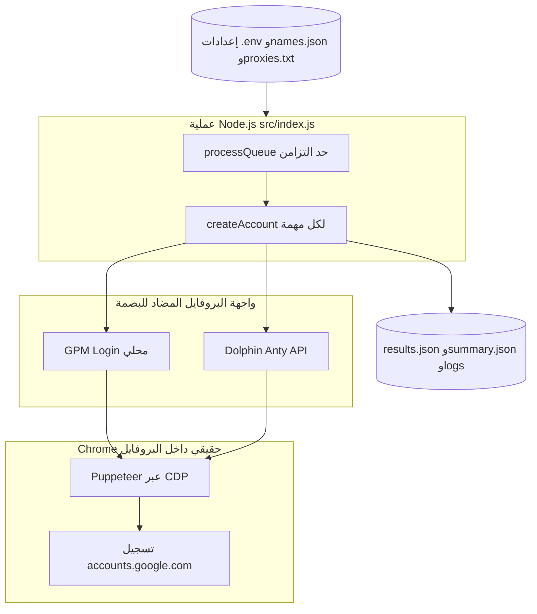
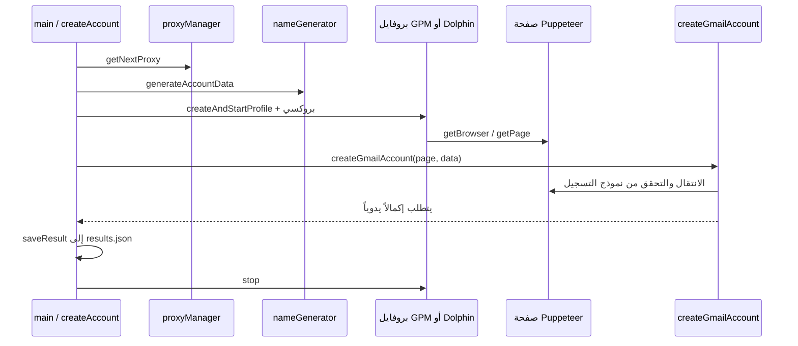
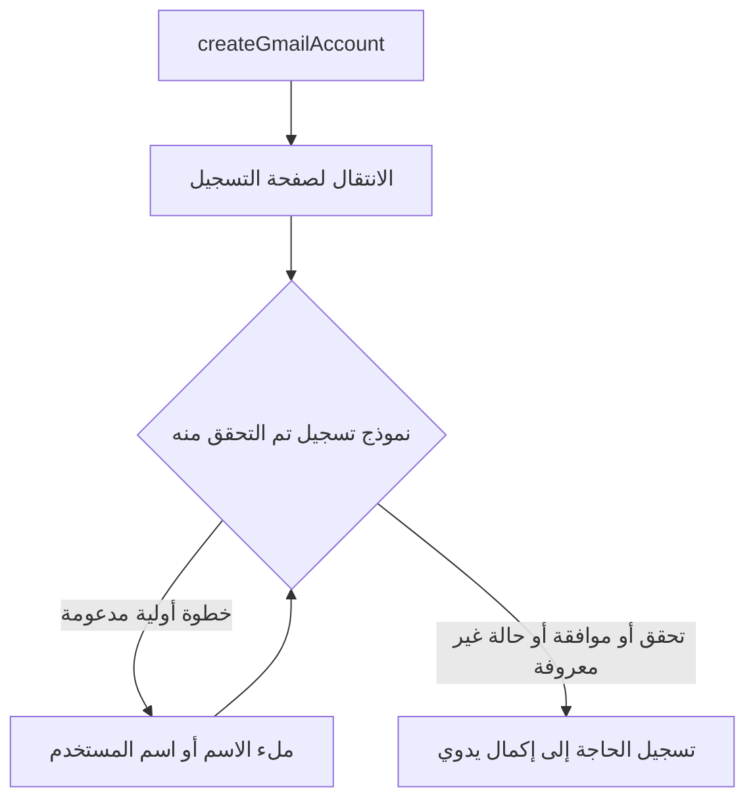

# منشئ حسابات Gmail — دليل عربي مفصّل

[](README.md)
[](https://github.com/code-root/gmail-account-creator)
[](https://github.com/code-root/gmail-account-creator/releases)
[](https://github.com/code-root/gmail-account-creator/pkgs/npm/gmail-account-creator)

## فهرس المحتويات

**انتقال سريع:** [English README (`README.md`)](README.md#table-of-contents) · [المستودع على GitHub](https://github.com/code-root/gmail-account-creator)

| القسم | |
|--------|---|
| [حول المشروع (About)](#حول-المشروع-about) | [وصف المشروع (تفصيل تقني)](#وصف-المشروع-تفصيل-تقني) |
| [المتطلبات قبل البدء](#المتطلبات-قبل-البدء) | [التثبيت — خطوة بخطوة](#التثبيت--خطوة-بخطوة) |
| [التشغيل — أوامر وشرح السلوك](#التشغيل--أوامر-وشرح-السلوك) | [ماذا يحدث داخل البرنامج؟](#ماذا-يحدث-داخل-البرنامج-تسلسل-العمليات) |
| [مخططات توضيحية](#مخططات-توضيحية) | [جدول الوحدات البرمجية](#جدول-الوحدات-البرمجية-ملف--مسؤولية) |
| [مرجع الدوال](#مرجع-الدوال-شرح-مختصر-لكل-دالة-مصدَّرة-أو-método-عام) | [المخرجات والسجلات](#المخرجات-والسجلات) |
| [الإصدارات و GitHub Packages](#الإصدارات-releases-وحزمة-github-packages) | [سير عمل GitHub المقترح](#سير-عمل-github-المقترح-حسب-التقنية) |
| [المطوّر والشركة والتواصل](#المطوّر-والشركة-والتواصل) | [دعم المشروع](#دعم-المشروع-support) |
| [تحذير قانوني وأخلاقي](#تحذير-قانوني-وأخلاقي) | [مراجع سريعة داخل المستودع](#مراجع-سريعة-داخل-المستودع) |

**المخططات (داخل القسم)**

- [السياق العام للنظام](#السياق-العام-للنظام)
- [تسلسل محاولة واحدة حتى التسليم](#تسلسل-محاولة-واحدة-حتى-التسليم)
- [مسار التسجيل داخل Gmail (منطقي)](#مسار-التسجيل-داخل-gmail-منطقي)
- [جدول — نموذج التزامن](#جدول--نموذج-التزامن)

**الإصدارات والحزم (أقسام فرعية)**

- [الخيار أ — إصدار تلقائي (مُستحسن)](#الخيار-أ--إصدار-تلقائي-مُستحسن)
- [الخيار ب — من واجهة GitHub: «Create a new release»](#الخيار-ب--من-واجهة-github-create-a-new-release)
- [التثبيت من GitHub Packages](#التثبيت-من-github-packages)
- [النشر التلقائي](#النشر-التلقائي)

**الدعم**

- [رموز QR للإيداع (امسح ضوئياً في Binance أو أي محفظة BSC)](#رموز-qr-للإيداع-امسح-ضوئياً-في-binance-أو-أي-محفظة-bsc)

---

## حول المشروع (About)

**منشئ حسابات Gmail** أداة **Node.js** تفتح مسار إنشاء حساب Google في بروفايل متصفح وتسجّل نتيجة المحاولة. تعالج الواجهة الحقول الأولية التي يمكن التحقق منها وتُسجّل حالة `MANUAL_SIGNUP_REQUIRED` عندما تتطلب الخطوة التالية تدخل صاحب الحساب. انتظر تأكيد إيقاف البروفايل المُدار قبل إكمال الخطوات المتبقية في متصفح موثوق تتحكم فيه.

| | |
|--|--|
| **المستودع** | [github.com/code-root/gmail-account-creator](https://github.com/code-root/gmail-account-creator) |
| **Releases** | [تبويب الإصدارات](https://github.com/code-root/gmail-account-creator/releases) — **Create a new release** من الواجهة، أو دفع وسم `v*` لإرفاق `.tgz` تلقائياً |
| **Packages** | [حزم npm على GitHub](https://github.com/code-root/gmail-account-creator/pkgs/npm/gmail-account-creator) — `@code-root/gmail-account-creator` |
| **المسؤول عن الصيانة** | مصطفى البغوري — [Storage TE](http://storage-te.com/) — [واتساب](https://wa.me/201001995914) |
| **الترخيص** | ISC — راجع [`LICENSE`](LICENSE) |

**الوصف القصير (Description) على GitHub (إنجليزي):**  
*Automated Gmail signup (Node.js ESM): GPM Login / Dolphin Anty antidetect, Puppeteer, OMO Captcha & SMS APIs. Proxies and human-like behavior to reduce blocks, restrictions, and ban risk.*

**بالعربية (معنى الوصف):** أتمتة إنشاء حسابات Gmail مع بروفايلات مضادة للبصمة وسلوك شبيه بالإنسان وبروكسيات — بهدف **تقليل الحظر والقيود وتقليل احتمال تقييد الحساب** (لا يوجد ضمان مطلق؛ يلتزم المستخدم بشروط الخدمات).

**الوسوم (Topics / Tags) على GitHub (حد أقصى 20):**  
`gmail` · `gmail-creator` · `automation` · `account-creation` · `puppeteer` · `nodejs` · `javascript` · `gpm-login` · `dolphin-anty` · `antidetect-browser` · `anti-ban` · `ban-avoidance` · `undetected-automation` · `captcha` · `recaptcha` · `sms-verification` · `browser-automation` · `dotenv` · `axios` · `github-packages`

---

هذا المستند يشرح **الخطوات والعمليات** بالتفصيل، ويتضمن **مخططات Mermaid**، **جداول للوحدات**، و**مرجعاً للدوال**. النسخة الإنجليزية في [`README.md`](README.md).

---

## وصف المشروع (تفصيل تقني)

التطبيق يشغّل **متصفحاً حقيقياً** داخل **بروفايل مضاد للبصمة** عبر:

- **GPM Login** (الافتراضي)، أو  
- **Dolphin Anty**

ثم يستخدم **Puppeteer** للاتصال بالمتصفح ومعالجة الخطوات الأولية المدعومة. يراجع صاحب الحساب طلبات التحقق والموافقة بنفسه. مكتبة **SMS Verification** منفصلة عن مسار التسجيل وتستخدم مفتاحها الخاص.

---

## المتطلبات قبل البدء

1. **Node.js 18 أو أحدث** (مستحسن).  
2. **GPM Login** أو **Dolphin Anty** أو محرك **Camoufox** مثبّت محلياً. اضبط عنوان HTTPS الموثوق لوحدة التحكم أو اسمح صراحة بعنوان HTTP الرقمي المحلي المطابق على مضيف موثوق. راجع [إعداد الاتصال](ENV_VARIABLES.md#browser-controller-connection).
3. ملف `config/proxies.txt` بصيغة صحيحة في مجلد الحالة عندما يتطلب وضع البروفايل بروكسي.
4. ملف `config/names.json` المُرفق بالمشروع لتوليد بيانات الحساب.

---

## التثبيت — خطوة بخطوة

### 1) استنساخ المشروع وتثبيت الحزم

```bash
git clone https://github.com/code-root/gmail-account-creator.git
cd gmail-account-creator
npm install
```

**ماذا يحدث؟** يتم تنزيل الاعتماديات من `package.json`، أهمها: `puppeteer-core`, `axios`, `dotenv`, `gologin`.

### 2) إنشاء ملفات الإعدادات الخاصة

على أنظمة POSIX، أنشئ مجلد الحالة والملفات التالية بحساب تشغيل التطبيق قبل إضافة المفاتيح وبيانات اعتماد البروكسي.

```bash
export GMAIL_CREATOR_STATE_DIR="$HOME/.local/state/gmail-account-creator"
(
  umask 077
  mkdir -p "$GMAIL_CREATOR_STATE_DIR/config" &&
    set -C &&
    cat .env.example > "$GMAIL_CREATOR_STATE_DIR/.env"
)
```

امنح المالك وحده صلاحية الوصول إلى الملفات العادية الموجودة بتعيين الوضع `0600` لكل من `.env` و`.emv` الاختياري و`config/proxies.txt` قبل تحريرها. على Windows، اضبط قائمة التحكم بالوصول لمجلد الحالة على NTFS وتحقق من أن صلاحيات الملفات الموجودة والجديدة تقتصر على حساب التشغيل وحسابات النظام المصرح لها.

**أهم المتغيرات:**

| المتغير | الوظيفة |
|---------|---------|
| `PROFILE_SERVICE` | `gpm` (افتراضي) أو `dolphin` أو `camoufox` لاختيار منصة البروفايلات |
| `GMAIL_CREATOR_STATE_DIR`, `GMAIL_CREATOR_LEGACY_DIR` | مسارات مطلقة لمجلدي الحالة والتهيئة السابقة، تُضبط في بيئة التشغيل |
| `GPM_API_URL` | عنوان API لـ GPM Login |
| `DOLPHIN_API_KEY`, `DOLPHIN_API_URL`, `DOLPHIN_FOLDER_ID` | إعدادات Dolphin عند اختيار `dolphin` |
| `GPM_TRUSTED_HTTP_API_URL`, `DOLPHIN_TRUSTED_HTTP_API_URL` | الموافقة الصريحة على عنوان HTTP الرقمي المحلي المطابق |
| `SMS_VERIFY_API_KEY` | مفتاح اختياري لاستخدام مكتبة SMS Verification بصورة مستقلة |
| `SMS_PROVIDER` | `sms-verification` — التفاصيل في [`ENV_VARIABLES.md`](ENV_VARIABLES.md) |
| `ACCOUNTS_COUNT` | عدد الحسابات المطلوب إنشاؤها في التشغيلة |
| `THREADS_COUNT` | عدد المهام المتزامنة (الخيوط) |

**ملاحظة:** الكود يحمّل `.env` أولاً، ويمكنه تجربة ملف `.emv` في حالات معيّنة إذا لم تُضبط متغيرات معيّنة — راجع `src/config.js`.

### 3) إعداد البروكسيات

الملف هو `config/proxies.txt` داخل مجلد الحالة. لاستخدام قائمة قديمة، انقل ملفها إلى مجلد الحالة أو اضبط `GMAIL_CREATOR_LEGACY_DIR` على مجلد التثبيت القديم واترك ملف القائمة في مجلد الحالة غير موجود. تأخذ القائمة الحالية الأولوية حتى إذا كانت فارغة أو تحتوي على تعليقات فقط.

- سطر لكل بروكسي.  
- الصيغة: `ip:port` أو `ip:port:username:password`  
- الأسطر التي تبدأ بـ `#` تُعتبر تعليقاً.

يتوقف التشغيل إذا كان أي سطر من غير التعليقات غير صالح.

### 4) إعداد الأسماء

الملف: `config/names.json` — يُستخدم لتوليد أسماء ومقترحات بريد منطقية ضمن `src/utils/name-generator.js`.

---

## التشغيل — أوامر وشرح السلوك

### تشغيل افتراضي (حساب واحد، خيط واحد)

```bash
npm start
```

### تشغيل دفعات مع تزامن

```bash
npm start -- --accounts=10 --threads=3
npm start -- -a=10 -t=3
```

أو:

```bash
ACCOUNTS_COUNT=10 THREADS_COUNT=3 npm start
```

**شرح المعاملات:**

- `--accounts` / `ACCOUNTS_COUNT`: كم **محاولة إنشاء** سيتم جدولتها.  
- `--threads` / `THREADS_COUNT`: كم **عملية متزامنة** تعمل في نفس الوقت. إذا كان عدد الخيوط أكبر من عدد الحسابات، يُعدّل البرنامج الخيوط لتطابق عدد الحسابات (راجع `src/index.js`).

### وضع التطوير (إعادة تشغيل عند التغيير)

```bash
npm run dev
```

يستخدم `node --watch` لملف الدخول.

### سكربت مجلدات Dolphin

```bash
npm run list-folders
```

مفيد عند ضبط `DOLPHIN_FOLDER_ID`.

---

## ماذا يحدث داخل البرنامج؟ (تسلسل العمليات)

يُنفَّذ المنطق الرئيسي في `src/index.js` بالترتيب التالي **لكل محاولة حساب**:

1. **اختيار بروكسي** من `proxy-manager` حسب الدور أو السياسة المعرفة في الكود.  
2. **توليد بيانات الحساب** (اسم، اسم مستخدم، إلخ) عبر `name-generator`.  
3. **إنشاء بروفايل** باسم يتضمن بادئة `Gmail_` والوقت، ثم **تشغيله** عبر GPM أو Dolphin.  
4. **ربط Puppeteer** بعنوان التصحيح البعيد (remote debugging) للمتصفح داخل البروفايل.  
5. **فتح مسار التسجيل** في `src/gmail/creator.js` ومعالجة الحقول الأولية المدعومة بعد التحقق من الصفحة.
6. عند ظهور كلمة المرور أو التحقق أو طلب اختياري أو الموافقة أو تأكيد الحساب أو صفحة غير معروفة، يسجّل التطبيق الحاجة إلى تدخل صاحب الحساب ويطلب إيقاف البروفايل.
7. حفظ حالة المحاولة في `results.json` دون تخزين كلمات المرور أو رموز التحقق أو بيانات اعتماد البروكسي.
8. محاولة إيقاف البروفايل وتسجيل أي حالة إيقاف أو حذف تعذّر تأكيدها في `summary.json`.

بعد انتهاء كل المهام، يُكتب **ملخص التشغيلة** في `summary.json` (إحصائيات نجاح/فشل، المدة، إعدادات مختصرة).

---

## مخططات توضيحية

يعرض GitHub مخططات [Mermaid](https://mermaid.js.org/) تلقائياً داخل ملفات Markdown. إن لم تظهر لديك محلياً، افتح المستودع على GitHub أو استخدم إضافة معاينة تدعم Mermaid.

### السياق العام للنظام



### تسلسل محاولة واحدة حتى التسليم



### مسار التسجيل داخل Gmail (منطقي)



### جدول — نموذج التزامن

| المفهوم | الشرح في هذا المشروع |
|--------|----------------------|
| **مهمة حساب** | استدعاء واحد لـ `createAccount()` = دورة حياة بروفايل واحد. |
| **Thread في السجلات** | بادعة تسجيل فقط؛ التنفيذ الفعلي عبر `async` وليس خيوط نظام تشغيل. |
| **التزامن** | `processQueue` يحدُّ أقصى عدد مهام متزامنة بـ `threadsCount`. |
| **حالة مشتركة** | كل مهمة لها بروفايلها؛ `proxyManager` يتتبع أسطر البروكسي المستخدمة. |

---

## جدول الوحدات البرمجية (ملف ← مسؤولية)

| المسار | المسؤولية |
|--------|-----------|
| `src/index.js` | معاملات سطر الأوامر، طابور المهام، `saveResult`، ملخص `summary.json`. |
| `src/config.js` | تحميل `.env` / `.emv`، كائن `config`، تحذيرات التحقق. |
| `src/gmail/creator.js` | أتمتة واجهة التسجيل؛ التصدير الرئيسي `createGmailAccount`. |
| `src/gmail/page-detector.js` | كشف نوع شاشة Google؛ دوال انتظار العناصر. |
| `src/captcha/omo-handler.js` | التحقق من الإضافة، إدخال المفتاح، `setupOMOCaptchaExtension`. |
| `src/gpmlogin/client.js` | طلبات HTTP إلى GPM (إنشاء/تشغيل/إيقاف البروفايل، بصمة). |
| `src/gpmlogin/profile.js` | صنف `GPMLoginProfile` ومصنع `createAndStartProfile`. |
| `src/dolphin/client.js` | واجهة REST لـ Dolphin (بروفايلات، مجلدات، بروكسي). |
| `src/dolphin/profile.js` | صنف `DolphinProfile` ومصنع `createAndStartProfile`. |
| `src/gologin/client.js` | عميل GoLogin السحابي (اختياري، ملف كبير). |
| `src/gologin/profile.js` | صنف `GoLoginProfile` ومصنع `createAndStartProfile`. |
| `src/providers/sms-provider.js` | اختيار مزود SMS الموحّد (SMS Verification). |
| `src/providers/sms-verification-api.js` | دوال HTTP لمزود SMS Verification. |
| `src/providers/fivesim-api-legacy.js` | يرفض طلبات المحول القديم الذي يستخدم HTTP. |
| `src/utils/logger.js` | مستويات السجل، ملف يومي تحت `logs/`. |
| `src/utils/proxy-manager.js` | قراءة `config/proxies.txt` وتنسيقات البروكسي. |
| `src/utils/name-generator.js` | توليد هوية من `config/names.json`. |
| `src/utils/human-behavior.js` | حركة فأرة، تمرير، كتابة بتأخير بشري. |

---

## مرجع الدوال (شرح مختصر لكل دالة مصدَّرة أو método عام)

> الدوال **الداخلية** داخل `creator.js` لا تُستورد من ملفات أخرى؛ مذكورة في جدول منفصل للتوضيح فقط.

### `src/index.js`

| الدالة / الرمز | النوع | الوظيفة |
|----------------|-------|---------|
| `saveResult` | دالة | إلحاق سجل واحد في `results.json` مع وقت ISO. |
| `createAccount` | async | المسار الكامل: بروكسي → بيانات → بروفايل → `createGmailAccount` → حفظ → تنظيف. |
| `processQueue` | async | تشغيل مصفوفة من دوال async بدون معاملات مع حد أقصى للتزامن؛ إرجاع إحصائيات. |
| `main` | async | تحليل argv/env، بناء الطابور، استدعاء `processQueue`، كتابة `summary.json`. |
| التصدير الافتراضي | كائن | `{ createAccount, main }` للاستخدام البرمجي. |

### `src/config.js`

| الرمز | الوظيفة |
|-------|---------|
| `config` | كائن يضم `profileService`, `gpmlogin`, `dolphin`, `gologin`, `omocaptcha`, `smsVerify`, `app`. |
| `default` | نفس `config`. |

### `src/gmail/creator.js`

| الدالة | الوظيفة |
|--------|---------|
| `createGmailAccount(page, accountData, options)` | يعالج الخطوات الأولية المدعومة ويُرجع خطأ `MANUAL_SIGNUP_REQUIRED` مع المرحلة التي يتولى فيها صاحب الحساب المتابعة. |

### `src/gmail/page-detector.js`

| الدالة | الوظيفة |
|--------|---------|
| `detectGmailPage` | تقدير نوع شاشة التسجيل الحالية. |
| `waitForElement` | انتظار ظهور محدد CSS. |
| `elementExists` | فحص وجود عنصر. |
| `waitForPageLoad` | انتظار اكتمال التحميل. |
| *(داخلية)* `detectSignInPage`, `detectSignUpPage`, `detectVerificationPage`, `detectByClassNames`, `detectByElements` | مساعدات لـ `detectGmailPage`. |

### `src/captcha/omo-handler.js`

| الدالة | الوظيفة |
|--------|---------|
| `checkRecaptchaExtension` | التحقق من وجود إضافة الكابتشا. |
| `openOMOCaptchaExtension` | فتح واجهة الإضافة. |
| `setOMOCaptchaKeyViaAPI` / `enterOMOCaptchaKey` | يطلبان إعداد المفتاح يدوياً في الإضافة. |
| `clickRecaptchaRefreshButton` | تحديث عنصر الكابتشا. |
| `setupOMOCaptchaExtension` | تسلسل إعداد OMO قبل الحاجة للكابتشا. |

### `src/gpmlogin/client.js`

| الدالة | الوظيفة |
|--------|---------|
| `generateAndroidUserAgent` | توليد User-Agent أندرويد. |
| `generateAndroidFingerprint` | بصمة جهاز للبروفايل. |
| `checkGPMConnection` | فحص الاتصال بـ GPM. |
| `createProfile` | إنشاء بروفايل مع بروكسي اختياري. |
| `startProfile` | تشغيل البروفايل وإرجاع عنوان التصحيح. |
| `stopProfile` | إيقاف مع إعادة محاولات. |
| `deleteProfile` | حذف البروفايل. |
| `getProfile` | جلب بيانات البروفايل. |

### صنف `GPMLoginProfile` في `src/gpmlogin/profile.js`

| الطريقة | الوظيفة |
|---------|---------|
| `start` | تشغيل البروفايل وحل نقطة WebSocket/CDP. |
| `getBrowser` | الاتصال عبر `puppeteer.connect`. |
| `getPage` | الحصول على تبويب/صفحة للعمل. |
| `stop` / `delete` | إيقاف أو حذف البروفايل. |
| `injectAntiDetectionScripts` | حقن سكربتات تخفيف كشف الأتمتة. |
| `createAndStartProfile` *(مصدَّرة)* | إنشاء ثم تشغيل وإرجاع كائن الجلسة. |

### `src/dolphin/client.js` (دوال مصدَّرة)

| الدالة | الوظيفة |
|--------|---------|
| `checkDolphinConnection` | التحقق من أن الواجهة تعيد قائمة البروفايلات. |
| `createProfile` / `startProfile` / `stopProfile` / `getProfile` | دورة حياة البروفايل. |
| `recycleProfile` / `deleteProfile` | ينقل الأول البروفايل إلى سلة المحذوفات ويتحقق من التأكيد. يُبلغ الثاني بأن الحذف النهائي غير مدعوم. |
| `updateProfileProxy` | تطبيق بروكسي على بروفايلات. |
| `getFolderList`, `getAllFolders`, `findFolderByName`, `createFolder`, `getFirstAvailableFolder`, `getOrCreateFolder` | إدارة المجلدات. |

### صنف `DolphinProfile` في `src/dolphin/profile.js`

| الطريقة | الوظيفة |
|---------|---------|
| `start`, `getBrowser`, `getPage`, `stop` | تشغيل البروفايل والاتصال به وإيقافه. |
| `recycle` / `delete` | ينقل الأول البروفايل إلى سلة المحذوفات. يُبلغ الثاني بأن الحذف النهائي غير مدعوم. |
| `createAndStartProfile` *(مصدَّرة)* | مصنع جاهز لـ Dolphin. |

### صنف `GoLoginProfile` في `src/gologin/profile.js`

| الطريقة | الوظيفة |
|---------|---------|
| `start`, `getBrowser`, `getPage`, `stop`, `delete` | دورة حياة GoLogin. |
| `createAndStartProfile` *(مصدَّرة)* | مصنع عند استخدام مسار GoLogin. |

### `src/gologin/client.js` — `GoLoginClient` (التصدير الافتراضي)

| الطريقة | الوظيفة |
|---------|---------|
| `request` | HTTP موثّق لـ API. |
| `getProfiles`, `getProfile`, `createProfile`, `updateProfile`, `updateProfileProxy` | إدارة البروفايلات. |
| `startProfile`, `stopProfile`, `deleteProfile` | تشغيل وإيقاف وحذف. |
| `testProxy`, `createProfileWithProxy` | اختبار بروكسي وإنشاء مدمج. |

### `src/providers/sms-verification-api.js`

| الدالة | الوظيفة |
|--------|---------|
| `getSmsVerifyBalance` | الرصيد. |
| `getSmsVerifyCountries`, `getSmsVerifyPrices`, `getSmsVerifyServices` | استعلامات الكتالوج/الأسعار. |
| `buySmsVerifyNumber`, `buySmsVerifyNumberV2` | شراء رقم لخدمة معيّنة. |
| `checkSmsVerifyOrder` | حالة الطلب. |
| `setSmsVerifyStatus` | تحديث حالة الطلب. |
| `cancelSmsVerifyOrder`, `finishSmsVerifyOrder`, `retrySmsVerifyOrder` | إدارة دورة الرقم. |
| `getSmsVerifyActivations` | قائمة التفعيلات. |
| `waitForSmsVerifyCode` | انتظار وصول الرمز. |
| `buyNumberAndGetSMS` | شراء + انتظار الرمز في استدعاء واحد معقّد. |

### `src/providers/sms-provider.js`

| الرمز | الوظيفة |
|-------|---------|
| `getBalance`, `buyNumber`, `buyNumberAndGetSMS` | واجهة موحّدة بعد تحميل المزود. |
| `getOrderStatus`, `waitForSMS` | متابعة الطلب والرسالة. |
| `cancelOrder`, `finishOrder`, `requestResend`, `setOrderStatus` | إدارة الطلب. |
| `reportNumberUsed` | واجهة توافق للمزود. |
| `getServiceName`, `getProviderType` | للسجلات والتشخيص. |
| `SMS_PROVIDER_INFO` | `{ current: SMS_PROVIDER }`. |
| أسماء بديلة | `buySmsVerifyNumber`, `waitForSmsVerifyCode`, … تطابق الواجهة القديمة. |
| `SMS_VERIFY_COUNTRIES` | إعادة تصدير ثوابت الدول. |

### `src/utils/logger.js`

| الرمز | الوظيفة |
|-------|---------|
| `logger` / `default` | `error`, `warn`, `info`, `debug` — للكونسول وملف السجل اليومي. |
| *(داخلية)* `formatMessage`, `shouldLog`, `writeLog` | تنسيق وفلترة المستوى. |

### `ProxyManager` في `src/utils/proxy-manager.js`

| الطريقة | الوظيفة |
|---------|---------|
| `loadProxies` | قراءة الملف. |
| `getNextProxy` | اختيار عشوائي من غير المستخدم. |
| `markAsUsed`, `releaseProxy`, `reset` | تتبع التوفر. |
| `getGPMLoginFormat`, `getGoLoginFormat` | تنسيق إعدادات البروكسي لواجهات إدارة الملفات الشخصية. قد تتضمن القيم بيانات المصادقة. |
| `getStringFormat` | يعيد السطر الأصلي من قائمة البروكسيات بما فيه بيانات المصادقة عند وجودها. |
| `getAvailableCount` | عدد تقريبي للبروكسيات المتاحة. |

لعرض عنوان البروكسي في السجلات، استخدم `redactProxyUrl(proxy)` من `src/camoufox/traffic-redaction.js`. يقتصر الناتج على البروتوكول والمضيف والمنفذ.

### `NameGenerator` في `src/utils/name-generator.js`

| الطريقة | الوظيفة |
|---------|---------|
| `loadNames` | تحميل JSON. |
| `getRandomName` | اسم أول عشوائي. |
| `generateUsername` | جزء محلي مقترح للبريد. |
| `generatePassword` | كلمة مرور قوية. |
| `generateAccountData` | كائن حساب كامل جاهز للتسجيل. |

### `src/utils/human-behavior.js`

| الدالة | الوظيفة |
|--------|---------|
| `randomDelay`, `getHumanDelay` | زمن عشوائي مناسب لنوع الحركة. |
| `humanSleep` | تأخير غير ثابت. |
| `humanMouseMove`, `getElementCenter` | مسار فأرة منحنٍ نحو هدف. |
| `humanClick`, `humanClickAt` | نقرة مع حركة وتوقيت. |
| `humanScroll`, `humanScrollToElement` | تمرير تدريجي. |
| `explorePageRandomly` | تفاعلات عشوائية خفيفة بالصفحة. |
| `humanType` | كتابة حرف بحرف مع أخطاء اختيارية. |
| `idleMouseMovement`, `simulateReading`, `performRandomAction` | محاكاة خمول المستخدم. |
| `humanWait` | انتظار مع إجراءات عشوائية أحياناً. |
| `simulateTabSwitch` | محاكاة تبديل نافذة/تركيز. |
| *(داخلية)* `bezierPoint`, `cubicBezierPoint`, `generateMousePath` | حساب مسار الفأرة. |

---

## المخرجات والسجلات

تُحفظ هذه الملفات داخل [مجلد حالة التطبيق](ENV_VARIABLES.md#configuration-and-local-state).

| الملف / المجلد | المحتوى |
|----------------|---------|
| `results.json` | سجل لكل محاولة (نجاح أو فشل) مع الطابع الزمني |
| `summary.json` | ملخص آخر تشغيلة كاملة |
| `logs/` | سجلات تفصيلية حسب `LOG_LEVEL` |

---

## الإصدارات (Releases) وحزمة GitHub Packages

في صفحة المستودع يظهر **Releases** و**Packages** في الشريط الجانبي. الروابط المباشرة:

| المنطقة | الرابط | الفائدة |
|---------|--------|---------|
| **Releases** | […/releases](https://github.com/code-root/gmail-account-creator/releases) | إصدارات مُوسومة، ملاحظات، وملف **`.tgz`** من `npm pack` عند دفع وسم `v*` |
| **Packages** | [npm package](https://github.com/code-root/gmail-account-creator/pkgs/npm/gmail-account-creator) | تثبيت **`@code-root/gmail-account-creator`** بعد `npm publish` |

اسم الحزمة على سجل npm الخاص بـ GitHub: **`@code-root/gmail-account-creator`** (نطاق الاسم يطابق مالك المستودع `code-root`).

### فحص كل إصدار قبل النشر

حضّر التزامًا خضع للمراجعة يتضمن إصدارًا جديدًا في `package.json`، ثم نفّذ [فحص الإصدار المشترك](README.md#preflight-for-every-release) قبل دفع الوسم أو النشر من الواجهة. يتحقق الفاحص من الإصدار وشجرة المصدر في الالتزام الذي يشير إليه الوسم فعليًا. قد يتيح GitHub أرشيف المصدر قبل تشغيل سير العمل. يرفض الفاحص الوسم التاريخي `v1.0.0` لاحتوائه على أمثلة قديمة لبيانات اعتماد.

### الخيار أ — إصدار تلقائي (مُستحسن)

أكمل فحص الإصدار، ثم ادفع الالتزام المراجع إلى `main` بالطريقة المعتادة. استخدم [أمر دفع كائن الوسم الذي اجتاز الفحص](README.md#option-a--automated-release-recommended). يتحقق سير العمل **Release** من الالتزام الموسوم ويشغّل اختبارات الأمان، ثم يرفق حزمة npm التي اجتازت الفحص بصفحة الإصدار وينشر الملف نفسه في GitHub Packages.

### الخيار ب — من واجهة GitHub: «Create a new release»

استخدم هذا المسار لوسم موجود على GitHub ويحتاج إلى إصدار. أكمل فحص الإصدار، ثم [تحقق من تطابق كائن الوسم البعيد](README.md#option-b--create-a-new-release-in-the-github-ui). بعد نجاح المقارنة، اختر الوسم الموجود في [**Releases**](https://github.com/code-root/gmail-account-creator/releases)، وأضف العنوان والملاحظات وانشر الإصدار. يتحقق سير العمل من الحزمة وينشرها في GitHub Packages. للوسم الجديد على GitHub، استخدم الخيار أ ثم عدّل الإصدار الناتج من الواجهة.

#### إذا كانت GitHub Actions معطّلة (مثلاً بسبب الفوترة)

أكمل فحص الإصدار، ثم أنشئ الحزمة من نسخة عمل نظيفة للالتزام الذي اجتاز الفحص. تحقق من تطابق الوسم البعيد قبل إرفاق الحزمة في الواجهة أو نشر الإصدار يدويًا. [خطوات التحقق والنشر المحلي](README.md#if-github-actions-are-blocked-eg-billing)

### التثبيت من GitHub Packages

أضف هذه الإعدادات إلى إعداد npm الخاص بالمستخدم (عادةً `~/.npmrc`). حمّل `GITHUB_PACKAGES_TOKEN` من مخزن بيانات الاعتماد إلى بيئة التشغيل قبل تشغيل npm. استخدم [رمز وصول](https://docs.github.com/en/packages/working-with-a-github-packages-registry/working-with-the-npm-registry) يملك `read:packages`.

```text
@code-root:registry=https://npm.pkg.github.com
//npm.pkg.github.com/:_authToken=${GITHUB_PACKAGES_TOKEN}
```

ثم:

```bash
npm install @code-root/gmail-account-creator
```

بعد التثبيت المحلي، شغّل الأمر من داخل المشروع.

```bash
npm exec -- gmail-account-creator --help
```

ثبّت الحزمة تثبيتًا عامًا لاستخدام الأمر من مسار `PATH` الخاص بالطرفية.

```bash
npm install --global @code-root/gmail-account-creator
gmail-account-creator --help
```

### النشر التلقائي

ينشر سير العمل **Release** الحزمة التي تم التحقق منها في GitHub Packages باستخدام `GITHUB_TOKEN` عند دفع وسم إصدار أو نشر إصدار من واجهة GitHub.

---

## سير عمل GitHub المقترح (حسب التقنية)

المشروع يستخدم **Node + ESM** بدون اختبارات Jest مدمجة في `package.json`. السيرات المضمّنة:

1. **CI** يثبّت التبعيات ويفحص الصياغة ويشغّل اختبارات الأمان عند الدفع أو فتح طلب دمج — `.github/workflows/ci.yml`
2. **Release** يتحقق من الوسم ويشغّل اختبارات الأمان ويفحص حزمة npm قبل نشرها في GitHub Packages. يؤدي دفع الوسم أيضًا إلى إرفاق الحزمة بصفحة الإصدار. ملف سير العمل هو `.github/workflows/release.yml`.
3. **Dependabot (اختياري):** تحديثات أسبوعية لـ `npm`.
4. **عدم رفع أسرار:** التأكد أن `.env` غير مرفوع.

شغّل `npm run test:security` من نسخة من الشيفرة المصدرية بعد تثبيت التبعيات. للتحقق من إصدار مثبّت، شغّل الاختبارات من وسم الإصدار المطابق.

---

## المطوّر والشركة والتواصل

| | |
|---|---|
| **المطوّر** | مصطفى الباجوري (Mostafa Al-Bagouri) |
| **الشركة** | **[Storage TE](http://storage-te.com/)** |
| **واتساب** | [+20 100 199 5914](https://wa.me/201001995914) |

---

## دعم المشروع (Support)

إذا كان هذا المشروع مفيداً لك، يمكنك — اختيارياً — دعم الصيانة والتطوير عبر أي قناة تناسبك.

| القناة | طريقة الدعم |
|--------|-------------|
| **PayPal** | [paypal.me/sofaapi](https://paypal.me/sofaapi) |
| **Binance Pay / UID** | **1138751298** — من تطبيق Binance (Pay / تحويل داخلي عند توفره). |
| **إيداع Binance (الويب)** | [إيداع العملات المشفرة (Binance)](https://www.binance.com/en/my/wallet/account/main/deposit/crypto) — سجّل الدخول، اختر الأصل، ثم شبكة **BSC (BEP20)**. |
| **عنوان BSC (للنسخ)** | `0x94c5005229784d9b7df4e7a7a0c3b25a08fd57bc` |

> **الشبكة:** استخدم **BSC (BEP-20)** فقط. هذا العنوان مخصص لـ **USDT (BEP-20)** و**BTC على BSC** (Binance-Peg / «BTC» على BSC داخل التطبيق)، بما يتوافق مع شاشات الإيداع في Binance. **لا ترسل** **بتكوين أصلي على السلسلة (on-chain BTC)**، ولا **ERC-20**، ولا **NFTs** إلى هذا العنوان.

### رموز QR للإيداع (امسح ضوئياً في Binance أو أي محفظة BSC)

| USDT · BSC | BTC · BSC |
|------------|-----------|
|  |  |

الصور محفوظة في [`assets/`](assets/) بأسماء ثابتة — راجع [`assets/README.md`](assets/README.md). النسخة الإنجليزية: [Support this project](README.md#support-this-project).

---

## تحذير قانوني وأخلاقي

أتمتة إنشاء حسابات Google قد **تخالف شروط استخدام Google** والقوانين المحلية. استخدم المشروع فقط في بيئات تملكها، وبإذن صريح، ولأغراض مشروعة (مثل اختبار أنظمتك الداخلية). المسؤولية الكاملة عن الاستخدام تقع على المستخدم.

---

## مراجع سريعة داخل المستودع

- [`USAGE.md`](USAGE.md) — أمثلة أوامر إضافية  
- [`ENV_VARIABLES.md`](ENV_VARIABLES.md) — شرح متغيرات البيئة والمزودين  
- [`SETUP.md`](SETUP.md) — ملاحظات إعداد (استبدل أي مفاتيح وهمية/قديمة بمفاتيحك الخاصة)  
- [`GITHUB_SETUP.md`](GITHUB_SETUP.md) — إعداد GitHub إن وُجد  

الرابط العام للمشروع: [https://github.com/code-root/gmail-account-creator](https://github.com/code-root/gmail-account-creator)
